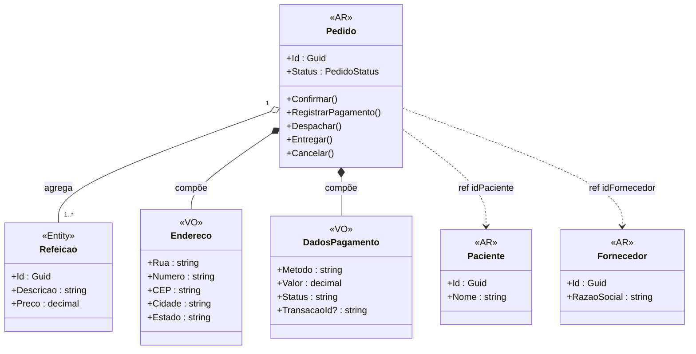

# Dinâmica: Design Estratégico do Projeto


# Equipe
| **RM**   | **Nome**                  |
|----------|---------------------------|
| 362550   | Rafael Gava Yokoyama      |
| 360671   | Victor Serrano Santos     |


## Objetivo
Identificar os subdomínios do projeto, classificá-los (Core, Supporting, Generic) e desenhar os bounded contexts, incluindo suas interações. Esse exercício ajudará a criar uma visão clara e estratégica do domínio.

---

## 1. Nome do Projeto
**AlphaNutri**

---

## 2. Objetivo Principal do Projeto
Conectar nutricionistas, pacientes e produtores de alimentos em uma única plataforma, facilitando consultas, acompanhamento nutricional personalizado e acesso a produtos e ingredientes saudáveis, promovendo hábitos alimentares mais adequados e sustentáveis.

---

## 3. Identificação dos Subdomínios

| **Subdomínio**                      | **Descrição**                                                                                                     | **Tipo**         |
|--------------------------------------|-------------------------------------------------------------------------------------------------------------------|------------------|
| Gestão de Consultas Nutricionais     | Gerencia agendamento, realização e acompanhamento das consultas nutricionais, incluindo histórico e planos.     | Core Domain      |
| Plano Alimentar Personalizado        | Criação, edição e acompanhamento de planos alimentares baseados nas necessidades e restrições do paciente.       | Core Domain      |
| Marketplace de Produtos Alimentícios | Conecta produtores de alimentos saudáveis a pacientes e nutricionistas, permitindo compra direta na plataforma.  | Core Domain      |
| Cadastro e Gestão de Usuários        | Registro, autenticação, permissões e perfis de nutricionistas, pacientes e produtores.                           | Supporting       |
| Pagamentos e Faturamento             | Processamento de pagamentos por consultas, planos e compras, incluindo repasse a nutricionistas e produtores.    | Generic          |
| Comunicação e Notificações           | Envio de mensagens, alertas e notificações para consultas, pedidos e atualizações de planos.                     | Supporting       |
| Relatórios e Análises                 | Geração de relatórios sobre evolução dos pacientes, métricas de vendas e desempenho de nutricionistas/produtores.| Supporting       |

---


## 6. Definição da Linguagem Ubíqua

| **Termo**             | **Descrição**                                                                                   |
|-----------------------|-------------------------------------------------------------------------------------------------|
| Consulta Nutricional  | Sessão entre nutricionista e paciente para avaliação e orientação alimentar.                    |
| Plano Alimentar       | Documento digital com refeições, porções e frequência, baseado nas necessidades do paciente.    |
| Paciente              | Usuário que recebe acompanhamento nutricional e/ou compra produtos no marketplace.              |
| Nutricionista         | Profissional de saúde habilitado para criar planos e prestar atendimento.                        |
| Produtor              | Fornecedor de alimentos saudáveis na plataforma.                                                 |
| Marketplace           | Ambiente digital para oferta e venda de produtos alimentícios.                                   |
| Pedido                | Transação de compra de produtos no marketplace.                                                  |
| Consulta Finalizada   | Status que indica conclusão do atendimento e entrega das recomendações.                          |
| Pagamento Processado  | Confirmação de que o valor foi recebido e repassado ao destinatário.                              |

---

## 7. Estratégia de Desenvolvimento

| **Subdomínio**                      | **Estratégia**                                     | **Ferramentas ou Serviços (se aplicável)**              |
|--------------------------------------|---------------------------------------------------|---------------------------------------------------------|
| Gestão de Consultas Nutricionais     | Desenvolvimento interno                           | -                                                       |
| Plano Alimentar Personalizado        | Desenvolvimento interno                           | -                                                       |
| Marketplace de Produtos Alimentícios | Desenvolvimento interno com futuras integrações   | Integração logística/pagamento                          |
| Cadastro e Gestão de Usuários        | Interno com autenticação segura                   | Auth0, Keycloak                                         |
| Pagamentos e Faturamento             | Terceirizar usando APIs de pagamento               | Stripe, PayPal, Mercado Pago                            |
| Comunicação e Notificações           | Interno com serviços de mensageria                 | Firebase Cloud Messaging, Twilio                        |
| Relatórios e Análises                 | Interno com possibilidade de integração de BI     | Metabase, Power BI Embedded                             |

---

## 8. Bounded Context

- **User**  
  Responsável por identidades e perfis de usuários.  

- **Nutrition Plan**  
  Gestão de planos de nutrição, consultas e assinaturas.  

- **Seller Management**  
  Cadastro e atributos dos sellers (fornecedores/parceiros).  

- **Product Catalog**  
  Catálogo de produtos, preços e restrições.  

- **Ordering**  
  Fluxo de pedidos: criação, atualização e status de ordens.  

- **Billing & Payment**  
  Cobranças, pagamentos e integração com PSPs externos.  

- **Notifications & Comms**  
  Envio de mensagens e notificações (event-driven).
  
#  Mapeamento de Contextos

| **Origem**         | **Destino**                   | **Tipo de Relacionamento**             | **Explicação**                                                                  |
|--------------------|-------------------------------|----------------------------------------|---------------------------------------------------------------------------------|
| User               | Todos                         | Customer–Supplier + Shared Kernel mínimo | Fornece identidades/perfis; compartilhar só tipos estáveis (UserId, Email).   |
| Seller Management  | Product Catalog               | Customer–Supplier                      | Cadastro/atributos de sellers alimentam o catálogo.                             |
| Product Catalog    | Ordering                      | Customer–Supplier                      | Ordering depende de itens, preços e restrições do catálogo.                     |
| Ordering           | Billing & Payment             | Customer–Supplier                      | Ordering solicita autorizações/capturas; Payments responde com status interno.  |
| Billing & Payment  | PSP externo                   | Anti-Corruption Layer                  | Tradução de status/erros do provedor para o modelo interno (protege o domínio). |
| Nutrition Plan     | Notifications & Comms         | Customer–Supplier (event-driven)       | Eventos PlanCreated/PlanUpdated disparam mensagens ao paciente.                 |
| Ordering           | Notifications & Comms         | Customer–Supplier (event-driven)       | Eventos OrderPlaced/OrderPaid/OrderFulfilled geram notificações.                |
| Nutrition Plan     | Billing & Payment (plano pago) | Customer–Supplier                     | Dispara cobranças de assinatura/sessão quando aplicável.                        |

# Design Tático no DDD

## **Domínio Escolhido**

**Nome do domínio:** Pedido  
**Objetivo do sistema:** Sistema para gerenciar planos nutricionais  
**Atores:** Clientes e Fornecedores  
**Contextos (opcional):** Product Catalog, Ordering, Billing & Payment

## **Entidades vs Value Objects**


| **Elemento**           | **Tipo**              | **Justificativa**                                                                                                                                                       |
| ---------------------- | --------------------- | ----------------------------------------------------------------------------------------------------------------------------------------------------------------------- |
| **Pedido**             | **Entidade (ROOT)**   | Possui **identificador único** e **ciclo de vida próprio** (criação, pagamento, entrega). Representa o agregado principal que coordena o estado e as regras de negócio. |
| **Paciente**           | **Entidade**          | Cada paciente tem **identidade própria e persistente** (ID, CPF ou cadastro). Pode existir sem o pedido e está presente em outros contextos do sistema.                 |
| **Fornecedor**         | **Entidade**          | Necessita de **identificação única** (CNPJ ou ID do sistema) e tem ciclo de vida independente, podendo ter vários pedidos associados.                                   |
| **Refeições**          | **Entidade**          | Cada refeição possui **identidade própria** dentro do pedido e pode ser alterada (itens, horário, observações) sem deixar de ser a mesma.                               |
| **Endereço**           | **Value Object (VO)** | É definido apenas por seus **valores (rua, número, cidade, CEP)** e não precisa de ID. Se algum dado muda, é um **novo endereço**, não o mesmo.                         |
| **Dados de Pagamento** | **Value Object (VO)** | Representam **informações imutáveis** sobre o pagamento (valor, método, status). Se algo muda, gera um **novo objeto**. Não possui identidade própria.                  |

# **Agregado: Pedido (Aggregate Root)**

| **Elemento**           | **Pertence ao Agregado?** | **Tipo (Entidade/VO)** | **Relação com o Pedido**                                                 | **Justificativa**                                                                         |
| ---------------------- | ------------------------- | ---------------------- | ------------------------------------------------------------------------ | ----------------------------------------------------------------------------------------- |
| **Pedido**             | ✅ Sim (Raiz do Agregado)  | **Entidade (ROOT)**    | Raiz do agregado. Controla ciclo de vida, regras e consistência interna. | Possui ID próprio e coordena todas as operações (criação, pagamento, cancelamento).       |
| **Paciente**           | ❌ Fora do agregado        | **Entidade**           | Referenciado por ID (`idPaciente`).                                      | Tem ciclo de vida independente e pertence a outro contexto (Cadastro de Pacientes).       |
| **Fornecedor**         | ❌ Fora do agregado        | **Entidade**           | Referenciado por ID (`idFornecedor`).                                    | É um outro contexto de negócio (Gestão de Fornecedores) e pode atender múltiplos pedidos. |
| **Refeições**          | ✅ Dentro do agregado      | **Entidade**           | Coleção de refeições pertencentes ao pedido.                             | Cada refeição é parte do pedido, não faz sentido existir sem ele.                         |
| **Endereço**           | ✅ Dentro do agregado      | **Value Object (VO)**  | Valor associado ao pedido (local de entrega).                            | É imutável e definido apenas por valores (rua, número, CEP).                              |
| **Dados de Pagamento** | ✅ Dentro do agregado      | **Value Object (VO)**  | Representa as informações de pagamento associadas ao pedido.             | Não possui identidade própria; é recriado quando há alteração no pagamento.               |

## **Resumo de Decisões de Modelagem**

- O **Pedido** é o **Aggregate Root**, responsável por garantir **consistência transacional local** (por exemplo, um pedido só pode ser pago se tiver endereço e refeição válidos).
    
- **Refeições, Endereço e Dados de Pagamento** ficam **dentro do agregado**, pois são parte da consistência interna.
    
- **Paciente e Fornecedor** ficam **fora**, pois pertencem a outros contextos e são referenciados apenas por **ID** (mantendo baixo acoplamento e consistência eventual).

#. Regras e Invariantes — Agregado: Pedido (Aggregate Root)

## Invariantes do Agregado (devem ser verdadeiras ao final de cada transação)

|**Código**|**Invariante**|**Descrição/Regra**|**Elementos envolvidos**|**Tipo**|**Quando validar**|
|---|---|---|---|---|---|
|INV-001|**Pedido deve ter pelo menos 1 refeição**|Não é permitido persistir pedido sem itens.|Pedido, Refeições|Estrutural|Criar/atualizar pedido|
|INV-002|**Endereço válido obrigatório**|Endereço completo e válido (rua, número, CEP/cidade).|Pedido, Endereço (VO)|Valor|Criar/atualizar endereço|
|INV-003|**Total = soma das refeições**|ValorTotal do pedido deve ser igual à soma dos subtotais das refeições.|Pedido, Refeições|Consistência|Adicionar/remover/atualizar refeição|
|INV-004|**Quantidade positiva**|Cada refeição/item deve ter quantidade > 0.|Refeições, Quantidade|Valor mínimo|Adicionar/atualizar refeição|
|INV-005|**Dados de pagamento coerentes**|Método e valor de pagamento devem existir e corresponder ao total.|Dados de Pagamento (VO)|Consistência|Registrar/alterar pagamento|
|INV-006|**Paciente e Fornecedor existentes**|`idPaciente` e `idFornecedor` devem referir-se a registros ativos.|Pedido, Paciente*, Fornecedor*|Referencial|Criar/ativar pedido|
|INV-007|**Imutabilidade pós-cancelamento/entrega**|Pedido **Cancelado** ou **Entregue** não pode sofrer alterações estruturais.|Pedido|Estado|Qualquer operação após transição final|

> _Observação:_ Paciente e Fornecedor são **referenciados por ID** (fora do agregado). A verificação é **referencial** (ex.: via domínio/ACL/consulta).

---

## Regras de Transição de Estado (máquina de estados do Pedido)

|**Estado atual**|**Ação**|**Pré-condições**|**Próximo estado**|**Bloqueios/Regras**|
|---|---|---|---|---|
|**Rascunho**|Confirmar pedido|INV-001, INV-002, INV-006 verdadeiras|**Aguardando Pagamento**|Não permitir se faltar endereço ou refeições|
|**Aguardando Pagamento**|Registrar pagamento|INV-003, INV-005 verdadeiras|**Pago**|Valor pago = ValorTotal; método suportado|
|**Pago**|Iniciar preparo|—|**Em Preparação**|—|
|**Em Preparação**|Despachar entrega|—|**Em Entrega**|—|
|**Em Entrega**|Confirmar entrega|—|**Entregue**|Após **Entregue**, estrutura imutável (INV-007)|
|**Qualquer** (exceto Entregue)|Cancelar pedido|Motivo de cancelamento informado|**Cancelado**|Após **Cancelado**, estrutura imutável (INV-007)|

---

## Políticas de Validação (pré/pós-condição) — exemplo rápido

- **Pré-condição (adicionar refeição):** quantidade > 0 (INV-004).
    
- **Pós-condição (atualizar item):** `ValorTotal == Σ(subtotais)` (INV-003).
    
- **Pré-condição (confirmar pedido):** tem endereço válido e ≥1 refeição (INV-001, INV-002).
    
- **Pós-condição (registrar pagamento):** dados de pagamento coerentes (INV-005) e estado **Pago**.
    

---

## Eventos de Domínio (indicativos)

- `PedidoConfirmado` (pós-commit de **Rascunho → Aguardando Pagamento**).
    
- `PagamentoRegistrado` (pós-commit de **Aguardando Pagamento → Pago**).
    
- `PedidoDespachado`, `PedidoEntregue`, `PedidoCancelado` (pós-commit das respectivas transições).
    

> Esses eventos suportam **consistência eventual** com outros BCs (Pagamento, Logística, Notificações).


# Repositório do Agregado (interface)

**Linguagem livre** (ex.: C#, Java, Kotlin, TS). Exemplo (C# assíncrono, adapte nomes):

```C#
namespace AlfaNutre.Pedidos.Domain
{
    using System;
    using System.Threading;
    using System.Threading.Tasks;

    // Aggregate Root
    public sealed class Pedido
    {
        public Guid Id { get; init; }
    }

    // Repositório do Agregado 
    public interface IPedidoRepository
    {
        Task AddAsync(Pedido pedido, CancellationToken ct = default);
        Task<Pedido?> GetByIdAsync(Guid id, CancellationToken ct = default);
        Task UpdateAsync(Pedido pedido, CancellationToken ct = default);
        Task RemoveAsync(Guid id, CancellationToken ct = default);
        Task SaveChangesAsync(CancellationToken ct = default);
    }
}
```

#  Serviços de Domínio

Os **serviços de domínio** representam **operações do negócio** que envolvem **duas ou mais entidades** ou **não pertencem naturalmente a uma única entidade**.  
Eles encapsulam **regras de negócio complexas** e mantêm o **modelo de domínio coeso**, delegando às entidades apenas as responsabilidades que lhes cabem.

|**Serviço**|**Responsabilidade (função principal)**|**Entrada**|**Saída / Resultado**|**Observações**|
|---|---|---|---|---|
|**ConfirmarPedidoService**|Valida e confirma um pedido em estado de _Rascunho_, alterando para _Aguardando Pagamento_.|`idPedido`, `idPaciente`, `idFornecedor`, `itens`, `endereco`|`Pedido` atualizado (confirmado)|Verifica invariantes como endereço válido e presença de refeições. Publica evento `PedidoConfirmado`.|
|**RegistrarPagamentoService**|Registra o pagamento de um pedido e altera o estado para _Pago_.|`idPedido`, `valorPago`, `metodoPagamento`|`Pedido` com status _Pago_|Valida o valor total e gera evento `PagamentoRegistrado`.|
|**DespacharPedidoService**|Inicia o envio do pedido após o pagamento, mudando para _Em Entrega_.|`idPedido`, `dadosEntrega`|`Pedido` com status _Em Entrega_|Aciona logística e emite evento `PedidoDespachado`.|
|**FinalizarEntregaService**|Confirma que o pedido foi entregue ao cliente.|`idPedido`, `assinatura`, `dataEntrega`|`Pedido` com status _Entregue_|Fecha o ciclo do pedido e publica evento `PedidoEntregue`.|
|**CancelarPedidoService**|Cancela um pedido por decisão do cliente ou problema operacional.|`idPedido`, `motivo`|`Pedido` com status _Cancelado_|Gera evento `PedidoCancelado` e aciona estorno no módulo de pagamentos.|

> 💡 **Observação:** todos os serviços devem ser **transacionais** dentro do agregado `Pedido` e publicar seus **eventos de domínio pós-commit**.  
> Isso garante **consistência local** (no agregado) e **consistência eventual** entre os demais contextos.


# Diagrama de Agregados/AR, Entidades e VOs (relacionamentos por ID entre agregados)


# Event Storming


